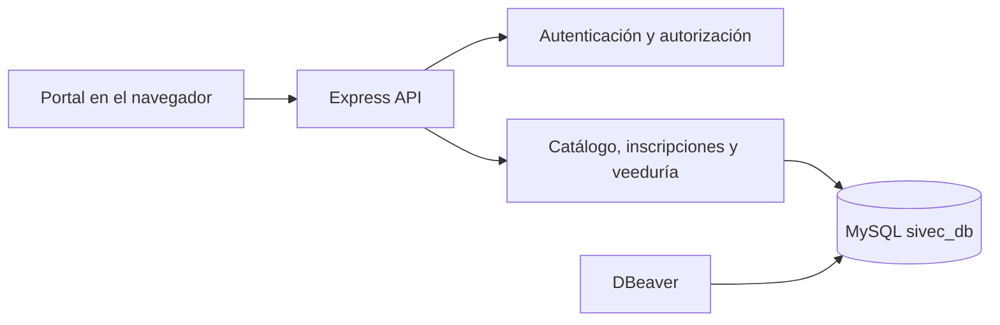

# Diseño de SIVEC

Fuente de requisitos: `REQUERIMIENTOS DEL PROGRAMA.docx`. SIVEC organiza la oferta deportiva y cultural municipal, facilita la inscripción y permite que la comunidad informe sobre el estado de los escenarios. La demostración se ejecuta en el mismo PC con Node.js, Express y MySQL. DBeaver permite consultar la base.

## Actores y permisos

| Actor | Consultas | Operaciones |
|---|---|---|
| Comunidad | Disciplinas activas, escenarios, semáforo, agenda e histórico de veedurías | Registrar un reporte con sus datos de contacto, sin cuenta |
| Deportista | Consultas públicas, búsqueda de entrenadores y disciplinas, historial propio | Inscribirse y reportar escenarios desde su cuenta |
| Entrenador | Buscar deportistas por nombre o disciplina, consultar inscritos y cronogramas propios | Registrar o actualizar las disciplinas que dicta, elegir escenario y gestionar su agenda |
| Administrativo | Buscar entrenadores y sus horarios, generar informes | Registrar, actualizar y dar de baja disciplinas, escenarios y cronogramas |
| CMJ | Reportes pendientes e histórico por escenario | Validar o rechazar y, después de validar, oficializar un cambio de semáforo |

El servidor comprueba el rol en cada operación protegida. El entrenador solo puede editar su propia agenda y consultar los inscritos de sus disciplinas. El deportista ve su propio historial. El histórico público muestra fechas, estado, validador y cambios de semáforo. Los datos de contacto e identificación del reportante quedan en MySQL.

## Arquitectura y datos

- `usuario` almacena las cuentas y sus roles. Las tablas `administrativo`, `entrenador`, `deportista` y `representante_cmj` almacenan los atributos específicos de cada rol. `usuario_comunidad` registra los datos de quien reporta sin cuenta.
- `disciplina` se relaciona con entrenadores mediante `entrenador_disciplina`. Cada `cronograma_entrenamiento` reúne una disciplina, un entrenador responsable, un escenario, días, horas y vigencia.
- `inscripcion` vincula al deportista con el cronograma. RN-01 exige que los días, las horas y la vigencia se crucen para rechazar una segunda inscripción. La API valida cupo antes de confirmar.
- `reporte_veeduria` registra el escenario, el reportante, la descripción y el resultado de la revisión. `historico_estado_semaforo` enlaza la oficialización con el reporte validado y el representante del CMJ que la efectuó.
- La baja de una oferta debe conservar el historial. Para escenarios y cronogramas se requiere un indicador de baja lógica y filtros en las consultas de disponibilidad.

## Flujos y criterios de aceptación

| Flujo | Criterio verificable |
|---|---|
| Inventario público | Sin iniciar sesión se ven las disciplinas activas y los cronogramas. Se puede buscar por nombre, categoría o ubicación y filtrar horarios por disciplina, escenario o entrenador. |
| Semáforo | Verde indica buen estado, amarillo mantenimiento y rojo deterioro. Cada escenario muestra ubicación y aforo. |
| Inscripción | Una sesión de deportista puede inscribirse a un cronograma con cupo. Si el horario se cruza con una inscripción confirmada, se rechaza el alta. La inscripción confirmada aparece en el historial personal. |
| Veeduría | Un visitante completa sus datos y envía un reporte. Un deportista autenticado usa los datos de su cuenta. Ambos envíos quedan pendientes. |
| Revisión | El CMJ acepta o rechaza un reporte pendiente con observaciones. Validar un reporte conserva el color actual. |
| Oficialización | El CMJ elige un color usando un reporte previamente validado. Se guarda el cambio y se actualiza el escenario. Una segunda oficialización sobre el mismo reporte se rechaza. |
| Histórico | Se consulta por escenario y muestra quién validó, cuándo lo hizo y el cambio oficial registrado. |
| Administración | Un administrativo registra, modifica o da de baja disciplinas, escenarios y cronogramas y consulta los informes del programa. |
| Entrenadores | El entrenador busca deportistas y consulta inscritos en sus disciplinas. Puede actualizar sus asociaciones y su agenda. |

## Diseño de informes

| Informe solicitado | Fuente propuesta | Acceso |
|---|---|---|
| Entrenadores registrados | `vista_reporte_entrenadores` | Administrativo |
| Deportistas por disciplina | `vista_deportistas_por_disciplina`, filtrada por asignación para el entrenador | Administrativo y entrenador asignado |
| Escenarios por semáforo | `vista_escenarios_por_semaforo` | Público |
| Disciplinas activas por categoría | `vista_disciplinas_activas_categoria` | Público |
| Cronograma por escenario, entrenador o deportista | `vista_cronograma_consolidado`; para el deportista, unir sus inscripciones | Público para oferta y deportista autenticado para su agenda |
| Histórico de veedurías | `vista_historico_veedurias_cmj` y proyección pública sin datos del reportante | Público y CMJ |
| Disciplinas con mayor demanda | `vista_ranking_demanda_disciplinas` | Administrativo |

## Alcance de la demostración actual

La versión actual cubre inicio de sesión, catálogo de disciplinas y entrenadores, búsqueda, cronogramas, escenarios, inscripción con histórico, reporte ciudadano y revisión y oficialización por CMJ. Quedan pendientes las pantallas de gestión administrativa y del entrenador, la consulta del detalle integral de un escenario y la publicación de los informes restantes. Los contactos públicos requieren definir cuáles son institucionales antes de mostrarlos.
